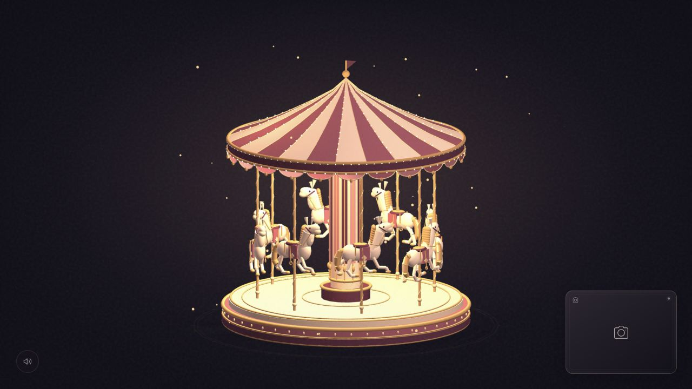
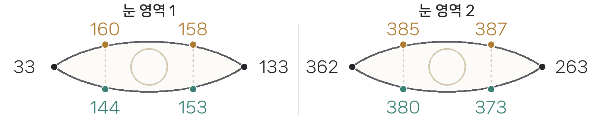

# Midnight Merry-go-round

눈을 감는 동안 빛과 음악으로 깨어나는 3D 회전목마. p5.js와 MediaPipe Face Landmarker로 구현한 웹 인터랙티브 아트입니다.

**[사이트 실행](https://53nu.github.io/Merry-go-round/)**

## 기획 의도

사용자가 회전목마에 관한 꿈을 꾸는 듯한 이미지를 목표로 했습니다. 눈을 감으면 조명과 음악이 켜지고 회전하지만, 눈을 떠 확인하려는 순간 멈춥니다. 비주얼이 펼쳐지는 동안 정작 참여자는 그 장면을 직접 보기 어렵다는 모순을 담았습니다.

## 사용 방법

1. 사이트 우측 하단 카메라 아이콘을 누르고 카메라 권한을 허용합니다.
2. 양쪽 눈을 감으면 약 190ms 확인 뒤 조명과 회전, 음악이 시작됩니다.
3. 눈을 뜨면 움직임이 멈추고 장식 조명과 음악이 빠르게 감쇠합니다.

카메라 영상과 얼굴 메쉬는 우측 하단에 겹쳐 표시됩니다. 영상은 브라우저 안에서 처리하며 서버로 전송하지 않습니다. 음악은 Web Audio API로 합성합니다.

## 문서

- [프로젝트 문서 PDF](project/Midnight_Merry-go-round_20221514.pdf)
- [수정 가능한 Word 문서](project/Midnight_Merry-go-round_20221514.docx)

## 눈 추적 지점

- 눈 영역 1: 33, 160, 158, 133, 153, 144
- 눈 영역 2: 362, 385, 387, 263, 373, 380

양쪽 눈의 EAR과 `eyeBlinkLeft`, `eyeBlinkRight`를 함께 사용합니다. 짧은 깜빡임은 걸러 내고 얼굴을 놓치거나 탭이 숨겨지면 효과를 멈춥니다.

## 구성

| 파일 | 역할 |
| --- | --- |
| `docs/scene.js` | p5.js WEBGL 회전목마와 조명 |
| `docs/app.js` | 카메라, MediaPipe 초기화와 메쉬 표시 |
| `docs/eye-state.mjs` | EAR 계산과 눈 상태 판정 |
| `docs/music.mjs` | Web Audio 음악 합성 |
| `docs/vendor/` | p5.js 1.11.3, MediaPipe Tasks Vision 0.10.21과 모델 |
| `project/` | 문서와 결과 이미지 |

GitHub Pages는 `main` 브랜치의 `/docs`를 배포합니다. 카메라는 HTTPS 또는 localhost 환경에서 사용할 수 있습니다.

20221514 고민우
